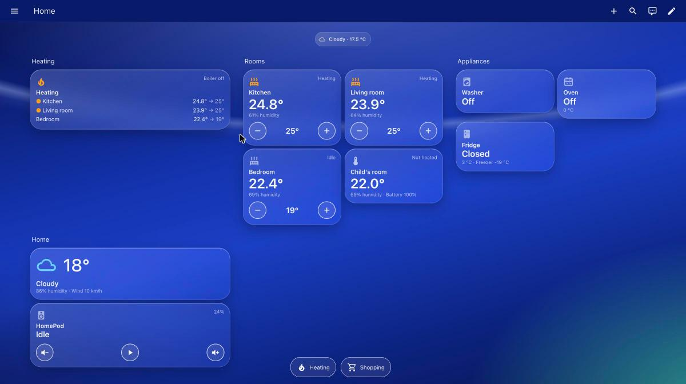

# HA Glass Kit

A small, entity-agnostic kit for **glass / iOS-style Home Assistant dashboards**: ten `custom:button-card` templates plus a dark/light theme. Tiles are frosted glass over a colourful background, readable at a glance, and reflow from one column on a phone to three on a laptop. Every component takes its entities as variables, so the same files work in any home.



An interactive layout preview is in [docs/mockup.html](docs/mockup.html) (download it and open it in a browser).

- **Two dependencies only**: `button-card` and `bubble-card` (pop-ups and footer, optional). No `card-mod`.
- **Works offline**: no web fonts, no hot-linked images.
- **Any screen**: built on the core `sections` view, no fixed pixel layout.
- **Theme optional**: every template has built-in fallbacks (dark look); the theme adds light mode and makes core cards match.

Status: **0.1.0**, running daily in one home on Home Assistant 2026.11. Issues and pull requests welcome (see [CONTRIBUTING.md](CONTRIBUTING.md)).

## Components
| Template | Entity | What it shows |
|---|---|---|
| [`kit_heat_room`](docs/components.md#kit_heat_room) | `climate.*` | Room temperature, humidity, target with − / +, heating / idle, "Sensor offline" |
| [`kit_sensor_room`](docs/components.md#kit_sensor_room) | temperature `sensor.*` | Sensor-only room: temperature, humidity, battery |
| [`kit_heat_overview`](docs/components.md#kit_heat_overview) | (list of `climate.*`) | All heated rooms at a glance + boiler relay |
| [`kit_schedule`](docs/components.md#kit_schedule) | schedule `sensor.*` | Weekly heating schedule: period pills, active one highlighted, base temperature, manual / schedule status; optional editor (pencil) |
| [`kit_appliance`](docs/components.md#kit_appliance) | any | Washer, oven, fridge, door: state, status pill, details, progress bar, ready time, quick button, opens a pop-up |
| [`kit_toggle`](docs/components.md#kit_toggle) | light / switch / input_boolean | One on/off control as a row, or a square tile with `square: true` (pop-ups) |
| [`kit_setpoint`](docs/components.md#kit_setpoint) | `number.*` / `input_number.*` | A number setting with − / + as a row (fridge temperature) |
| [`kit_banner`](docs/components.md#kit_banner) | (list of sensors) | Coloured pop-up header with big numbers (fridge / freezer, oven now / target) |
| [`kit_value`](docs/components.md#kit_value) | any | Square tile: icon, name, big value (washer temp / spin, door) |
| [`kit_weather`](docs/components.md#kit_weather) | `weather.*` | Condition icon, temperature, humidity, wind |
| [`kit_media`](docs/components.md#kit_media) | `media_player.*` | Now playing, volume − / +, play/pause |
| [`kit_youtube_header` / `kit_youtube_row`](docs/components.md#kit_youtube_header--kit_youtube_row) | `sensor.youtube_results` | YouTube search status + result rows in a speaker pop-up; tap plays the audio (needs the `yt_audio` integration + Music Assistant) |
| [`kit_stats`](docs/components.md#kit_stats) | (list of sensors) | 2–3 numbers side by side (power, energy, speed) |
| [`kit_spacer`](docs/components.md#kit_spacer) | none | Invisible space above a fixed footer bar |
| [`kit_tile`](docs/components.md#kit_tile) | any | Base tile every component extends |
| [`kit_button`](docs/components.md#kit_button) | any | Round 44 px action button used inside components |

## Requirements
- **Home Assistant** with `sections` views, `grid_options` and the heading card. Tested on 2026.11.0; older versions are untested.
- **[button-card](https://github.com/custom-cards/button-card)** (tested v7.0.1): required.
- **[bubble-card](https://github.com/Clooos/Bubble-Card)** (tested v3.4.3): only for pop-ups and the footer bar.
- Install both from **Settings → Marketplace** (HA 2026.11+) or **HACS** (older versions).
- Python 3 + PyYAML, only if you use `tools/build_ui.py` for UI-mode dashboards.

## Install

### 1. Install the cards
Settings → Marketplace (or HACS) → search **button-card** → Download. Same for **Bubble Card**. Reload the browser when HA asks.

### 2. Install the theme (optional, recommended)
1. Make sure `configuration.yaml` loads a themes folder:
   ```yaml
   frontend:
     themes: !include_dir_merge_named themes
   ```
   (If you add this line, restart Home Assistant once.)
2. Copy [`theme/glass.yaml`](theme/glass.yaml) to `/config/themes/glass.yaml`. The easiest way is the **File editor** add-on (Settings → Add-ons → File editor): create the `themes` folder, a new file `glass.yaml`, paste, save. Samba or SSH work too.
3. Developer tools → Actions → `frontend.reload_themes` → Perform action. No restart needed.
4. **Pick the theme on each device**: click your user name (bottom left) → Theme → **glass**. A view's `theme:` styles the dashboard only; the top bar and sidebar follow the per-device profile setting.

### 3. Add the dashboard
Pick one of the two ways. UI mode is simpler; YAML mode keeps the templates in separate files.

#### UI mode (default dashboards, edited in the browser)
UI-mode dashboards cannot `!include` files, so the templates are pasted inline:
1. Download this repo (Code → Download ZIP) and unpack it on your computer.
2. Copy [`examples/full.yaml`](examples/full.yaml) to `my-dashboard.yaml` and replace the example entity ids with yours (Developer tools → States lists them).
3. Build: `python3 tools/build_ui.py my-dashboard.yaml > out.yaml` (needs `pip install pyyaml`).
4. Settings → Dashboards → Add dashboard → New dashboard from scratch → name it → open it.
5. ✏️ Edit → ⋮ → **Raw configuration editor** → replace everything with the contents of `out.yaml` → Save.

When you change the dashboard later, edit `my-dashboard.yaml`, rebuild, paste again. To update the kit, download the new version and rebuild.

Without Python: paste the contents of every file in `templates/` under one `button_card_templates:` key at the top of the raw configuration, then your `views:`.

#### YAML mode (files on the HA host)
1. Copy the `templates/` folder to `/config/dashboards/kit/templates/`.
2. Copy `examples/full.yaml` to `/config/dashboards/glass.yaml` and replace the entity ids. It already starts with
   `button_card_templates: !include_dir_merge_named kit/templates`.
3. Register the dashboard in `configuration.yaml` and restart:
   ```yaml
   lovelace:
     dashboards:
       dashboard-glass:
         mode: yaml
         title: Glass
         icon: mdi:home
         show_in_sidebar: true
         filename: dashboards/glass.yaml
   ```
4. Later changes to the YAML show after a browser refresh (no restart).

### 4. Pop-ups and footer (bubble-card)
- A pop-up is a `custom:bubble-card` with `card_type: pop-up` and a `hash` (e.g. `"#heating"`); a tile opens it with `tap_action: {action: navigate, navigation_path: "#heating"}`.
- **Set `bg_color`, `bg_opacity` and `bg_blur` on every pop-up.** bubble-card ignores theme variables for the pop-up backdrop, so without them the pop-up is a solid default colour. For the dark glass theme: `bg_color: "#0c2380"`, `bg_opacity: 55`, `bg_blur: 16`.
- The footer is a `horizontal-buttons-stack` fixed over the page. Put it in a last full-width section (`column_span` = the view's `max_columns`) together with a `kit_spacer`, or the last row hides behind the bar. `examples/full.yaml` shows the whole pattern.

### 5. Check
Open the dashboard on a phone and on a laptop. Tiles with a wrong entity id show "—" and dim; fix the id. Buttons on a tile without an entity do nothing (by design).

## Using a component
```yaml
type: custom:button-card
template: kit_heat_room
entity: climate.living_room
name: Living room
variables:
  humidity: sensor.living_room_humidity
grid_options: {columns: 6, rows: auto}
```
Use `columns: 6` for normal tiles and `columns: 12` for wide ones, always with `rows: auto`. Every option of every component: [docs/components.md](docs/components.md).

## Docs
| Doc | What |
|---|---|
| [docs/components.md](docs/components.md) | Every component: options and example YAML |
| [docs/design-system.md](docs/design-system.md) | Theme tokens, tile anatomy, sizes, states, why it looks like glass |
| [docs/layout.md](docs/layout.md) | How to lay out a dashboard: sections, chips, pop-ups, footer |
| [docs/new-component.md](docs/new-component.md) | Writing a component for a new device type |
| [docs/mockup.html](docs/mockup.html) | Interactive layout preview (open in a browser) |
| [examples/](examples/) | `minimal.yaml` (two tiles), `full.yaml` (every component, pop-up, footer) |

## Credits
The visual idea is inspired by Alistair Merritt's "iOS inspired tablet dashboard" (r/homeassistant). This kit is written from scratch; none of that dashboard's code is used.

## Licence
[MIT](LICENSE) © 2026 Fakhri Aliyev
